# Image to TikZ

**把技术路线图、深度学习网络架构图重建为可编辑的 LaTeX / TikZ。**

PaddleOCR-VL 校对文字，agent 从图片恢复组件与连接，确定性渲染器生成统一样式、相对布局和可编译源码。支持特征图堆叠、立体网格、渐变、投影面、多类型箭头与中文局部加粗。

[安装与教程](#安装与教程) · [转换结果](#转换结果) · [PaddleOCR Token](#paddleocr-api) · [GPT image_gen](#gpt-image_gen) · [独立安装包](https://github.com/Under-no-Flag/image-to-tikz/releases/latest) · [测试与通用性审查](docs/testing-and-generality.md)

这是一套 **agent 视觉理解 + OCR + 原生 TikZ 生成与核验** 的 skill。它不是单条命令自动识别所有图拓扑的转换器；换图仍需要读图、构建 Scene 和视觉复查。输出包括 `scene.json`、`figure.tex`、`styles.tex`、完整 `preview.tex`、矢量 PDF 与高清 PNG。

## 转换结果

每组 **左侧为实际输入图，右侧为转换后的高清图**，点击可查看原尺寸。转换图从矢量 PDF **以 600 DPI 直接渲染**，没有放大旧 PNG。输入图保留转换时的像素分辨率；页面只选某个 Figure 时，展示实际使用的图体裁切。这里只展示图片对照，完整 TeX、Scene、PDF 与验收记录留在本地。

| 案例 | 展示版本 | 转换图像素 |
|---|---|---:|
| LeNet | 图片重建后，源码对照校正字号/线宽 | 5693 × 1596 |
| Transformer | 原盲测验收被后验推翻，另存源码辅助修正版 | 5767 × 3434 |
| ST-SSL | 图片 + PaddleOCR | 5388 × 1560 |
| 立体特征网络 | 图片 + PaddleOCR + 一个生成 icon 资产 | 2716 × 4908 |
| GMAN Figure 4 | 仅图体，不含页面其他文字 | 3978 × 1852 |
| 轨道交通路线图 | 图片重建，首轮后局部修正 | 4094 × 8786 |
| 景区研究路线图 | 图片重建，首轮后局部修正 | 3601 × 4778 |

### LeNet：堆叠数、特征图比例、感受野连接

<table>
<tr><th width="50%">输入图</th><th width="50%">转换后 · 600 DPI</th></tr>
<tr><td><a href="examples/lenet/input.png">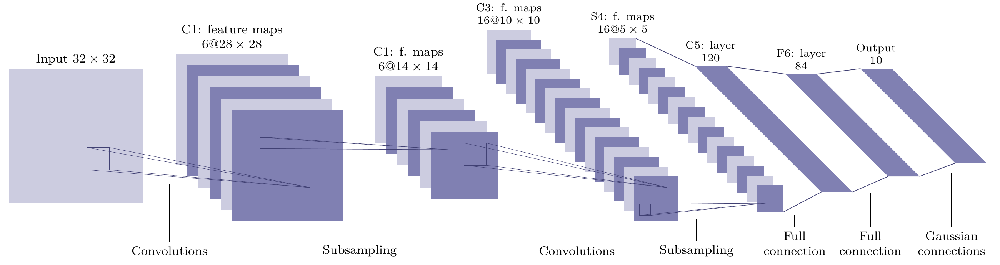</a></td><td><a href="examples/lenet/output.png">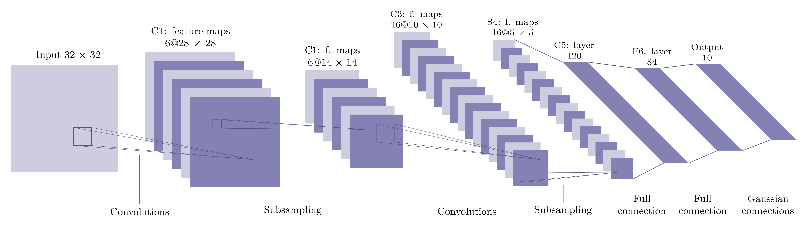</a></td></tr>
</table>

保留 6 / 6 / 16 / 16 层的可见堆叠和不同特征图尺寸。展示版的字号、线宽经过原始 TikZ 对照修正，因此不记为纯图片盲测结果。参考来自 [Deep-Learning-TikZ](https://github.com/maximxue/Deep-Learning-TikZ)。

### Transformer：分组、残差、局部放大、多头堆叠

<table>
<tr><th width="50%">输入图</th><th width="50%">转换后 · 600 DPI</th></tr>
<tr><td><a href="examples/transformer/input.png">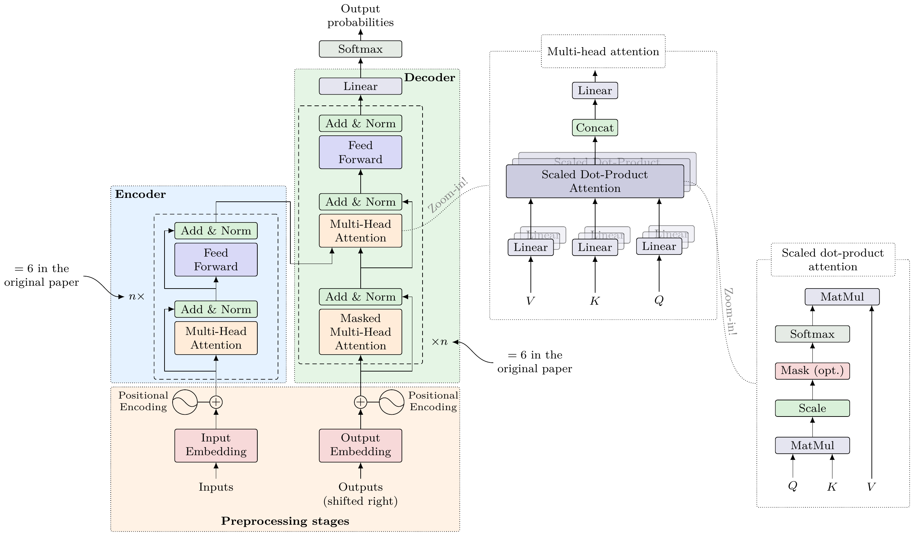</a></td><td><a href="examples/transformer/output.png">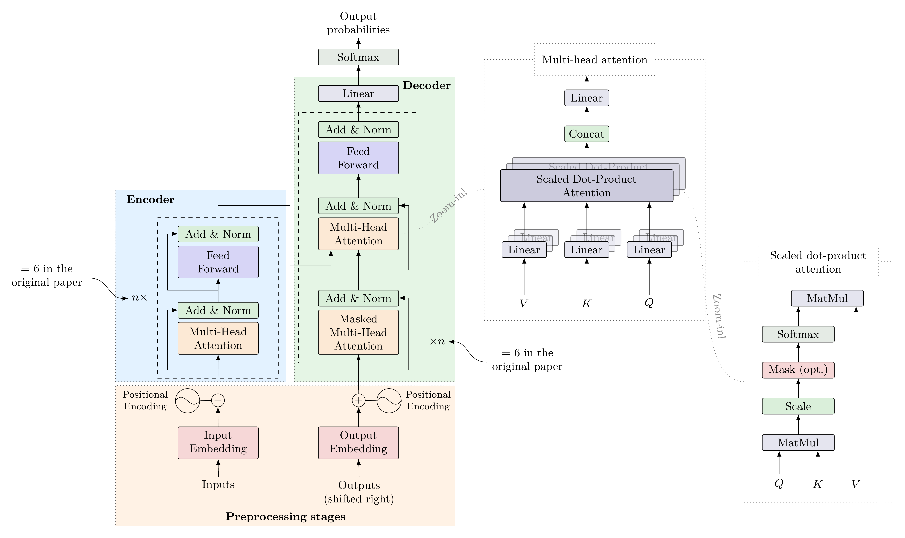</a></td></tr>
</table>

原盲测曾按架构常识多画连线与标签；源码后验发现后保留旧记录并另存修正版。这个案例形成了“逐条核对可见端点，不按模型知识补线”的通用规则。参考同样来自 Deep-Learning-TikZ。

### ST-SSL：多面板、增强反馈、散点与小图网络

<table>
<tr><th width="50%">输入图</th><th width="50%">转换后 · 600 DPI</th></tr>
<tr><td><a href="examples/st-ssl/input.png">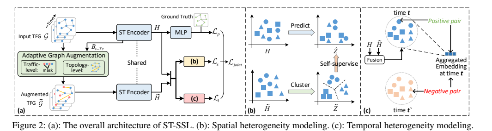</a></td><td><a href="examples/st-ssl/output.png">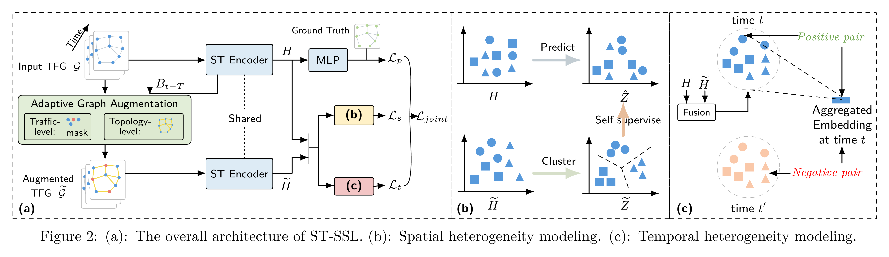</a></td></tr>
</table>

全部为原生图元。低分辨率源图中的小图细边、散点位置及字体仍有近似；未读取目标模型源码或原始 TikZ。

### 立体特征网络：魔方网格、渐变、投影与语义图标

<table>
<tr><th width="50%">输入图</th><th width="50%">转换后 · 600 DPI</th></tr>
<tr><td><a href="examples/projected-features/input.png">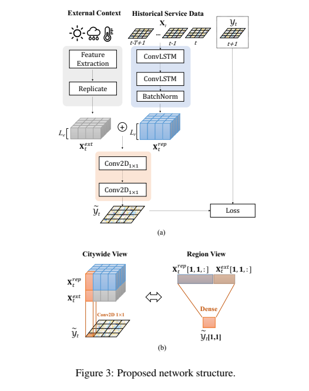</a></td><td><a href="examples/projected-features/output.png">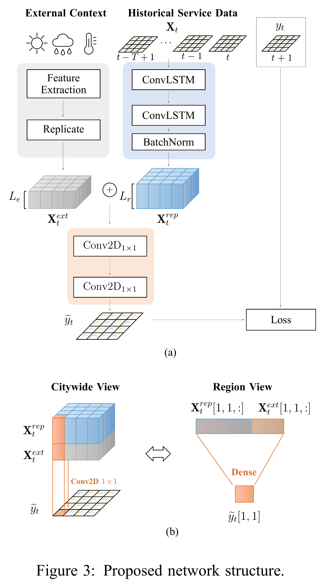</a></td></tr>
</table>

张量三面、网格、渐变、文字和连线均可编辑。天气图标由 **GPT image_gen** 单独生成，为可替换透明 PNG；图标内部笔画不能作为 TikZ 编辑，实际提示词、尺寸和哈希保存在本地完整结果的 `scene.json`。

### GMAN：只复刻 Figure 4

<table>
<tr><th width="50%">输入图</th><th width="50%">转换后 · 600 DPI</th></tr>
<tr><td><a href="examples/gman-figure4/input.png">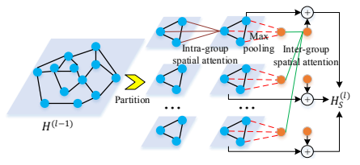</a></td><td><a href="examples/gman-figure4/output.png">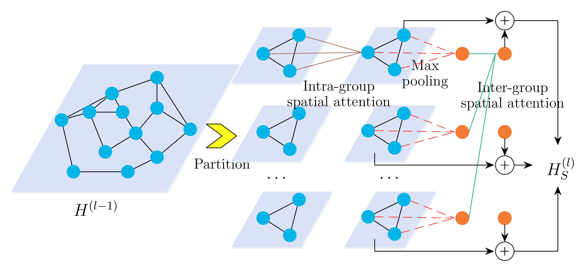</a></td></tr>
</table>

保留节点、投影面、池化/插值连接、残差和操作符。普通线不擅自加箭头；未重建原页其他段落。阴影、光晕和字体度量存在近似。

### 轨道交通路线图：线条重量与局部加粗

<table>
<tr><th width="50%">输入图</th><th width="50%">转换后 · 600 DPI</th></tr>
<tr><td><a href="examples/rail-roadmap/input.png">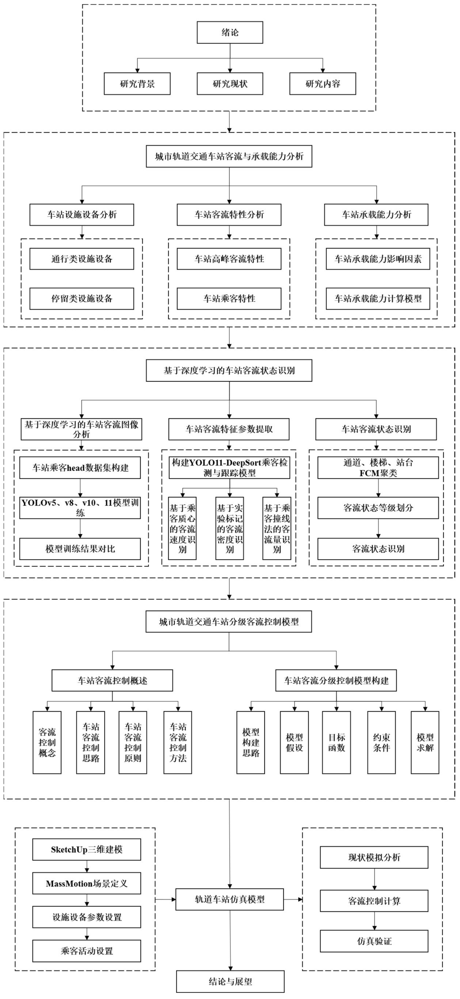</a></td><td><a href="examples/rail-roadmap/output.png">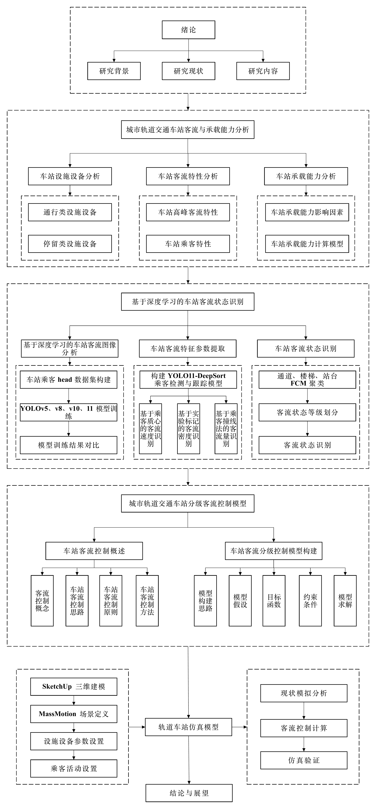</a></td></tr>
</table>

仅重建图1-2图体。中文常规体、英文局部粗体；有一处两行标签的断行位置不同。所有文字、框和箭头为原生 TikZ。

### 景区研究路线图：三列布局、分支层级与反馈

<table>
<tr><th width="50%">输入图</th><th width="50%">转换后 · 600 DPI</th></tr>
<tr><td><a href="examples/scenic-roadmap/input.png">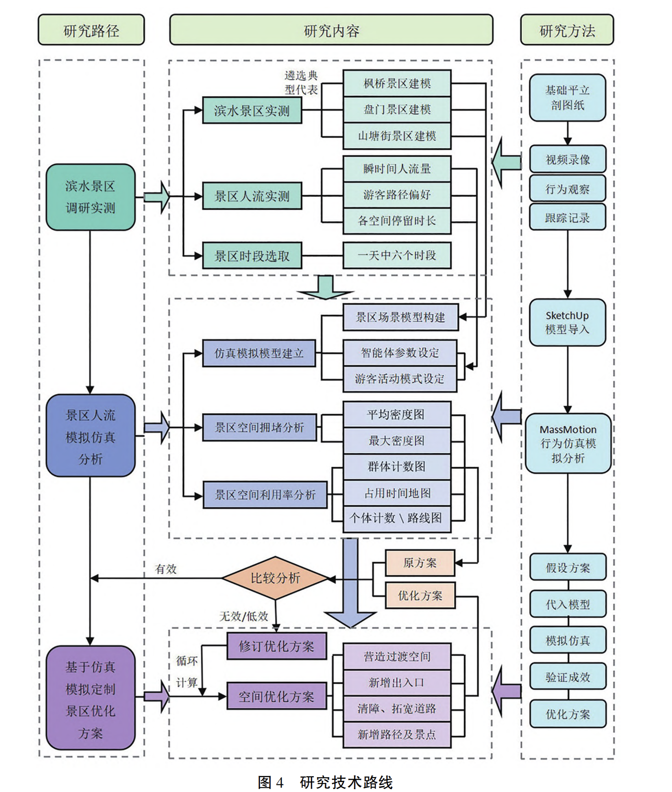</a></td><td><a href="examples/scenic-roadmap/output.png">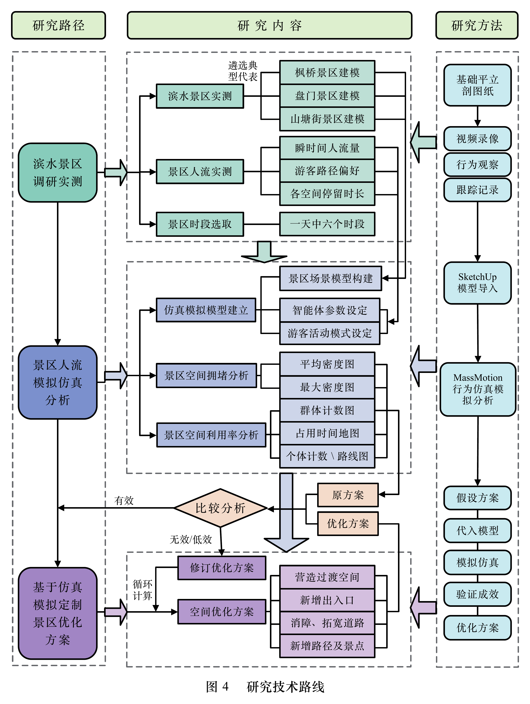</a></td></tr>
</table>

实际 OCR 支持 **9 / 52 个文字节点**，另 43 个经图像人工转录与复核；不能把返回块映射率当作全图识别准确率。两张中文路线图都经过修订，不宣称一次无误转换。计时与首轮差异见[测试说明](docs/testing-and-generality.md)。

## 安装与教程

需要：能查看图片并执行本地脚本的 agent、Python 3.10+、XeLaTeX、Poppler、PaddleOCR API Token。生成独立 icon 时还需要宿主提供 GPT image_gen；普通图的原生重建不依赖生图。

### 1. 安装 skill

从 [Releases](https://github.com/Under-no-Flag/image-to-tikz/releases/latest) 下载 `image-to-tikz-0.1.0.zip`，解压后将整个 `image-to-tikz/` 文件夹放进 agent 的 skill 目录。安装包只含 skill 自身的脚本、文档、模板与许可证，不含测试图、Token、案例答案或其他 skill。

也可以克隆安装：

```bash
git clone https://github.com/Under-no-Flag/image-to-tikz.git
cd image-to-tikz
python3 tools/install_skill.py --dest "$HOME/.agents/skills/image-to-tikz"
```

当前 Codex 文档使用 `~/.agents/skills` 或项目 `.agents/skills`，见 [OpenAI 官方 skill 文档](https://learn.chatgpt.com/docs/build-skills)。已使用 `~/.codex/skills` 的桌面环境可以把 `--dest` 改成该环境实际加载的目录。本项目开发机使用后者；不要同时安装两个同名副本。安装脚本遇到已有目录会停止，避免覆盖本地修改。

以下命令假设安装在 `~/.agents/skills/image-to-tikz`：

```bash
SKILL_DIR="$HOME/.agents/skills/image-to-tikz"
python3 -m venv "$HOME/.venvs/image-to-tikz"
"$HOME/.venvs/image-to-tikz/bin/python" -m pip install -r "$SKILL_DIR/requirements.txt"
```

### 2. 安装 TeX 和渲染工具

macOS：

```bash
brew install --cask mactex-no-gui
brew install poppler
```

安装后重开终端。命令对应 [MacTeX cask](https://formulae.brew.sh/cask/mactex-no-gui) 与 [Poppler formula](https://formulae.brew.sh/formula/poppler)。已有 TeX 环境无需重复安装；脚本要求 `xelatex`、`pdftoppm`、`pdfinfo` 在 PATH 中。

Ubuntu / Debian：

```bash
sudo apt-get update
sudo apt-get install texlive-xetex texlive-lang-chinese texlive-latex-extra poppler-utils fonts-noto-cjk
```

使用 `fontspec`、`xeCJK`、TikZ 和 `geometry`，无需 `standalone.cls`。Windows 建议 WSL2；原生 Windows 未验证。完整环境与字体替换说明见 [operations.md](skills/image-to-tikz/references/operations.md#tex-环境与字体)。示例中的 Songti SC / Times New Roman 不随仓库分发；换字体后需重查换行与字号。

### PaddleOCR API

这是 AI Studio 的 PaddleOCR-VL **异步 jobs API**；无需本地 GPU 或安装 paddlepaddle。前往 [PaddleOCR 控制台](https://aistudio.baidu.com/paddleocr) 和 [Access Token 页面](https://aistudio.baidu.com/account/accessToken) 获取可用 Token。

推荐配置在 **`~/.image-to-tikz/config.yaml`**：

```yaml
PADDLE_OCR_TOKEN: "填写自己的 Token"
```

```bash
mkdir -p ~/.image-to-tikz
chmod 700 ~/.image-to-tikz
# 用编辑器创建并填写 config.yaml 后：
chmod 600 ~/.image-to-tikz/config.yaml
"$HOME/.venvs/image-to-tikz/bin/python" "$SKILL_DIR/scripts/workflow.py" doctor
```

也支持环境变量 `PADDLE_OCR_TOKEN`，优先级高于配置文件；兼容读取 `~/.editppt/config.yaml`。不把 Token 写入仓库、Scene 或分享的日志。`doctor` 只检查存在性，真实 `ocr` 请求才验证账号权限。

默认服务地址 `https://paddleocr.aistudio-app.com/api/v2/ocr/jobs`，模型 `PaddleOCR-VL-1.6`；支持 `ocr --model`。整图被识别为 image 或仅返回图注时，先试一个紧裁文字区，再决定是否补识别。接口细节、缓存、分区 OCR 与错误处理见 [API 教程](skills/image-to-tikz/references/operations.md#api-配置教程)。不承诺服务额度或长期可用性。

### GPT image_gen

当图片包含需要重画的天气、人物等**独立语义 icon**，且用户要求生成时，由宿主 agent 调用实际提供的 GPT `image_gen` 工具。要求透明背景，保存返回 PNG、完整 prompt、尺寸与 SHA-256；然后通过相对路径嵌入 TikZ。

本 skill 不附带生图模型或第三方 API 代理，也没有 `GPT_IMAGE_TOKEN` 配置项。PaddleOCR Token 不用于生图。宿主必须已提供 image_gen；仅安装本目录不会获得该工具。工具不可用时明确报告该步骤，不能假造生图成功。特征图、渐变网格、文字和箭头仍用原生 TikZ。详见[资产格式与流程](skills/image-to-tikz/references/projected-features-icons.md)。

### 3. 开始转换

向 agent 提交图片并使用：

```text
$image-to-tikz 把 /absolute/path/diagram.png 转成可编辑 TikZ。
只看图片，用 PaddleOCR 校对；保留特征图比例、堆叠、箭头类型、字号和局部加粗。
先留存首次渲染，再核验和修正。输出到一个新目录，交付 PDF 和 600 DPI PNG。
```

只要页面中的一个图时说明“仅 Figure 4 图体”。不要让 agent 根据常见网络结构补画图片中不存在的连线。

脚本流程如下，**中间的读图和 Scene 编写由 agent 完成**：

```bash
PYTHON="$HOME/.venvs/image-to-tikz/bin/python"
RUN="$PWD/outputs/my-diagram-001"
"$PYTHON" "$SKILL_DIR/scripts/workflow.py" prepare /absolute/path/diagram.png --out "$RUN" --width-mm 170
"$PYTHON" "$SKILL_DIR/scripts/workflow.py" ocr "$RUN"
# agent 查看 source.png / OCR，按参考文档编写 scene.json
"$PYTHON" "$SKILL_DIR/scripts/workflow.py" build "$RUN"
"$PYTHON" "$SKILL_DIR/scripts/first_pass.py" "$RUN"
"$PYTHON" "$SKILL_DIR/scripts/workflow.py" review-template "$RUN"
# 实际看图检查六项，必要时修改并重新构建；填写 review.json
"$PYTHON" "$SKILL_DIR/scripts/workflow.py" check "$RUN" --final
"$PYTHON" "$SKILL_DIR/scripts/workflow.py" export "$RUN" --out "$PWD/exports/my-diagram-600" --dpi 600
```

工作预览默认 300 DPI，独立导出默认 600 DPI，可指定 72–1200 DPI；独立导出不会改动验收签名。矢量 PDF 最适合论文排版；提高 DPI 不会恢复原图里看不清的细节。

## 编辑与复用

`scene.json` 保存语义、共享样式、相对位置、尺寸组和图元参数；修改后用工作流生成。`figure.tex` / `styles.tex` 可直接编辑，完整编译入口是 `preview.tex`：

```bash
cd /absolute/path/your-output
xelatex -no-shell-escape -interaction=nonstopmode -halt-on-error preview.tex
```

README 中只提供图片对照；新转换任务会生成完整可编辑文件。请在任务副本上修改。使用 Scene 重新生成时，修改 Scene 才能保留到下次生成；手改 TeX 的内容会被生成器覆盖。

规范按需阅读：[跨图流程](skills/image-to-tikz/references/reconstruction-playbook.md) · [Scene 格式](skills/image-to-tikz/references/scene-format.md) · [网络图元](skills/image-to-tikz/references/network-glyphs.md) · [立体/渐变/图标](skills/image-to-tikz/references/projected-features-icons.md) · [线宽与字重](skills/image-to-tikz/references/first-pass-style-calibration.md)。

## 开发、测试与打包

```bash
python3 -m venv .venv
.venv/bin/python -m pip install -r skills/image-to-tikz/requirements.txt
.venv/bin/python -m unittest discover -s tests -v
.venv/bin/python tools/package_skill.py
```

发布包在 `dist/`，附 SHA-256 文件；相同内容可重复生成相同 ZIP。测试包含真实 XeLaTeX 编译、OCR 协议模拟、图元/布局约束、资产哈希、首轮冻结，以及把 ZIP 解压到陌生目录后构建新场景和高清导出。没有 Token 的 CI 不发真实 OCR 或生图请求。

`tests/cases/` 是已观察案例的坐标化记录，`examples/cases.json` 只是画廊索引；两者都不进入 skill 安装包，也不被核心脚本读取。`test-images/` 用于本地放图，开发时仅选择指定图片，不要求跑完整图集。通用性审查与测试局限见[报告](docs/testing-and-generality.md)。

## 来源与许可

Skill、通用脚本及原创说明采用 [MIT](LICENSE)。PaddleOCR jobs 适配参考 [ningzimu/image-to-editable-ppt-skill](https://github.com/ningzimu/image-to-editable-ppt-skill)，保留 [MIT notice](skills/image-to-tikz/THIRD_PARTY_NOTICES.md)。

**案例图不统一适用根目录 MIT。** LeNet / Transformer 图像保留上游 AGPL-3.0 许可，最低限度的对应 TeX 源保存在许可目录；其他用户提供的论文/截图图式保留原作者权利，不在此额外授予原图许可。来源、范围和许可见 [examples/ATTRIBUTION.md](examples/ATTRIBUTION.md)。
